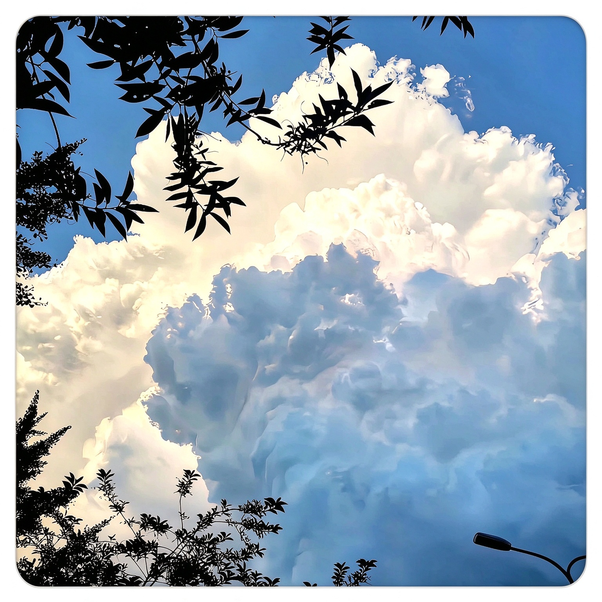

云边有个小卖部，货架摆着晨光泥香旧歌普通的日子

> 云边有个小卖部，货架上摆着天空的蓝、晚风的温柔，和一点点没说出口的心事。
> 
> A little shop at the edge of the clouds — shelves lined with the blue of the sky,
> the softness of the evening wind,
> and a few words left unsaid.
>
> 
——《云边有个小卖部》

✨ 日子像云，聚了又散；人像风，来了又走。但总有些想把生活过得亮晶晶的念头，会被天空悄悄收好。✨

Days drift like clouds, gathering and scattering; people come and go like the wind. Yet the wish to make life a little brighter is quietly kept by the sky.

Contributor and Developer of [@dzt2006/learning-journey](https://github.com/dzt2006/learning-journey)

Nice to meet you. 愿你的每一天，云很轻，天很蓝，笑很甜。 🫧

 

🟦 方块慢慢落，日子慢慢叠

<picture>
  <source media="(prefers-color-scheme: dark)" srcset="https://raw.githubusercontent.com/dzt2006/dzt2006/output/tetris-contribution-graph-dark.svg">
  <source media="(prefers-color-scheme: light)" srcset="https://raw.githubusercontent.com/dzt2006/dzt2006/output/tetris-contribution-graph.svg">
  
</picture>

